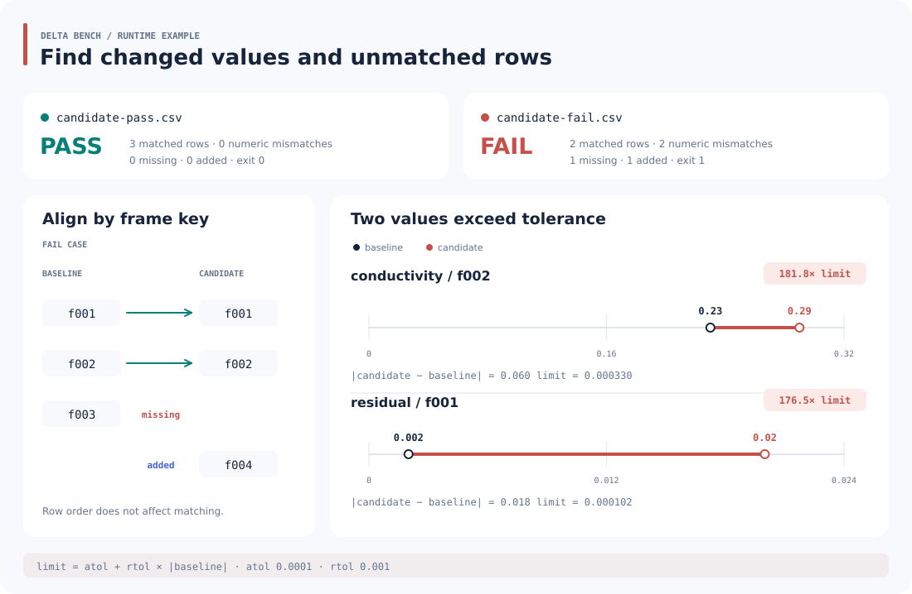

<p></p>

# Delta Bench

按唯一键比较两份 CSV 数值结果，找出超差、缺失行和新增行。输出 JSON 与 HTML 报告，并用退出码控制 CI 是否继续，适合数值计算与 EIT 流水线的回归检查。

## 运行示例

同一份基线，对照两个候选结果：一个全部通过，另一个有 2 项超差，缺少 `f003`、新增 `f004`。



图中数据来自实际运行的 [通过报告](reports/pass.json) 与 [失败报告](reports/fail.json)。小图分别使用自己的数值横轴，倍数为差异除以该项容差。

需要 Python 3.10+。在项目根目录执行，无第三方依赖：

```sh
python -m delta_bench examples/baseline.csv examples/candidate-pass.csv \
  --key frame --columns conductivity,residual --atol 0.0001 --rtol 0.001 \
  --json reports/pass.json --html reports/pass.html

python -m delta_bench examples/baseline.csv examples/candidate-fail.csv \
  --key frame --columns conductivity,residual --atol 0.0001 --rtol 0.001 \
  --json reports/fail.json --html reports/fail.html
```

第一条退出 `0`，第二条退出 `1`。浏览器打开 `reports/pass.html` 或 `reports/fail.html` 查看明细。stdout 始终输出 JSON，`--json`、`--html` 额外保存文件。

## 怎样判定通过

对基线值 b 与候选值 c，满足下式即通过：

```text
|c − b| ≤ atol + rtol × |b|
```

- 相对容差以基线为准；基线为零时使用绝对容差。
- 两个容差默认都是 0，即严格数值相等。按数据单位和允许误差设置它们。
- 任意超差、缺失键、新增键或没有共有键，整体结果都失败。
- 每列输出 MAE、RMSE、最大绝对差与超差数量；统计包括所有共有键。

每条超差记录包含键、列名、两值、绝对差与实际容差。JSON 使用 `schema_version: 1`；键按字符串排序，列按参数顺序输出。

## 输入与输出

- CSV 为带表头的 UTF-8 文件，兼容 BOM；列名唯一，行宽一致。
- `--key` 列必须非空且唯一。键按原始字符串匹配，行顺序可以不同。
- `--columns` 显式指定数值列，两份文件都须包含这些列；其他辅助列不比较。
- 所选数值必须有限，NaN、Inf、空值和非数字会报错。容差须为有限非负数。
- 报告目录须已存在；同名报告会覆盖，输入文件受到覆盖保护。

退出码 `0`：通过；`1`：有效比较发现差异；`2`：参数、输入或写入错误。CI 可直接使用退出码作为检查结果，并保存 JSON/HTML 供回查。

## 开发

```sh
python -m unittest discover -s tests -v
```

- `core.py`：CSV 校验、键对齐、容差与指标，可导入 `compare` 使用。
- `report.py`：HTML 报告。
- `__main__.py`：命令行、文件输出与退出码。
- `examples/`：基线、通过候选、失败候选三份数值样例。

计算采用双精度浮点，全量数据在内存中处理。比较前统一单位与键的含义；CI 每次使用独立输出目录，便于区分本次结果和历史报告。
